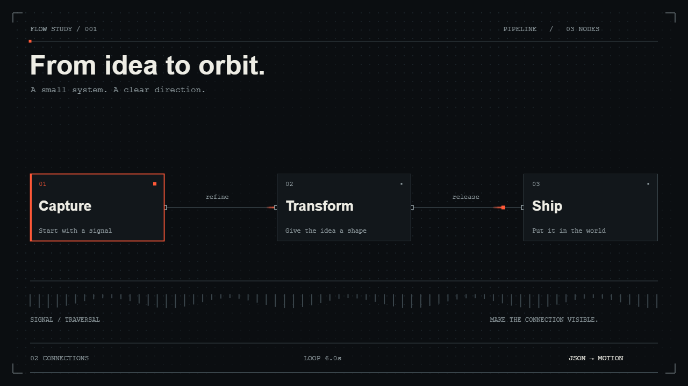
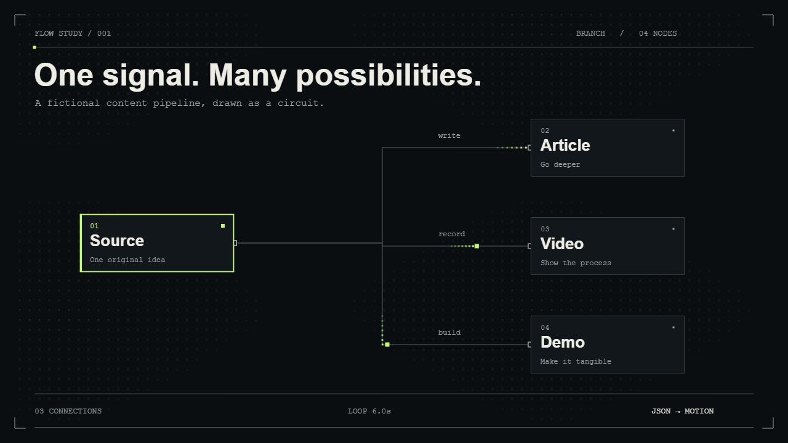
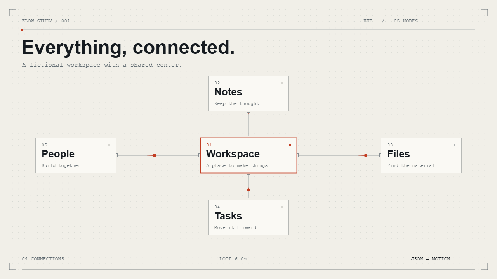

# Wiremotion

[English](README.md) · [한국어](README.ko.md) · [简体中文](README.zh-CN.md) · [日本語](README.ja.md) · [Español](README.es.md)

**Turn small JSON diagrams into schematic motion GIFs for your README.**

[Open the playground](https://jeffrog-256k1.github.io/wiremotion/) · [Configuration](docs/configuration.md) · [Examples](examples)

<picture>
  <source media="(prefers-reduced-motion: reduce)" srcset="assets/pipeline.png">
  
</picture>

[View the still image](assets/pipeline.png)

Give a workflow some motion: halftone fields, precise wiring, traveling signals, and one accent color. Edit JSON in the playground, then save a GIF and a still PNG. Your diagram is processed in your browser; there is no upload service, account, or API key.

## Make your first diagram

1. Open the [playground](https://jeffrog-256k1.github.io/wiremotion/).
2. Choose **Pipeline**, **Branch**, or **Hub**. Edit the labels in the JSON panel.
3. Choose a theme, then **Export GIF** and **Save PNG**.
4. Copy the README snippet and place both images in your repository's `assets/` folder.

Invalid JSON keeps the last valid preview visible and disables export. Export runs in a worker and can be cancelled. Diagram content is not auto-saved: download your JSON before leaving the page. Only your language preference is saved locally.

## Five languages

The playground and this README are available in **English, Korean, Simplified Chinese, Japanese, and Spanish**. Use the language menu at the top of the playground or share a link with `?lang=en`, `?lang=ko`, `?lang=zh-CN`, `?lang=ja`, or `?lang=es`.

Switching language preserves your JSON, theme, and diagram. Buttons, validation errors, accessibility labels, and export status are translated. Example content, technical artwork captions, JSON keys, CLI output, and the advanced configuration reference remain in English. You can write your own diagram labels in any supported system font.

## Three small templates

| Template                           | A good fit for                         | Shape                   |
| ---------------------------------- | -------------------------------------- | ----------------------- |
| [Pipeline](examples/pipeline.json) | Build steps, releases, data processing | 2–5 nodes, in order     |
| [Branch](examples/branch.json)     | One input, several outputs             | One root + 2–4 leaves   |
| [Hub](examples/hub.json)           | Shared workspace, service connections  | One center + 2–5 spokes |

<details>
<summary>See Branch and Hub in motion</summary>

<picture>
  <source media="(prefers-reduced-motion: reduce)" srcset="assets/branch.png">
  
</picture>

[Branch still image](assets/branch.png)

<picture>
  <source media="(prefers-reduced-motion: reduce)" srcset="assets/hub.png">
  
</picture>

[Hub still image](assets/hub.png)

</details>

## Run locally

Requires **Node.js 22.12+** and npm. No Python, FFmpeg, external fonts, or paid service is needed.

```sh
git clone https://github.com/jeffrog-256k1/wiremotion.git
cd wiremotion
npm ci
npm run dev
```

Open **http://127.0.0.1:4317**. The development server listens on loopback only. The browser editor needs a current browser with Canvas, Web Workers, and OffscreenCanvas; Chromium is the primary tested browser. The initial site and asset download still uses the network; diagram processing and exports happen locally.

### Render from a file

```sh
npx playwright install chromium
npm run render -- examples/pipeline.json --out renders/my-flow
```

This builds the app, renders through a temporary loopback server, and writes `my-flow.gif`, `my-flow.png`, and `my-flow.md`. Existing outputs are preserved unless you pass `--force`. The generated Markdown is relative to the exported images; adjust the paths when moving it into a README.

On Linux, browser system dependencies may be needed: `npx playwright install --with-deps chromium`. You can alternatively set `WIREMOTION_BROWSER_CHANNEL=chrome` to use an installed Chrome. No npm package is published yet; these commands run from the cloned repository.

## The input is just JSON

```json
{
  "version": 1,
  "title": "A small idea, shipped.",
  "layout": "pipeline",
  "nodes": [
    { "id": "idea", "label": "Idea", "detail": "Find the question" },
    { "id": "ship", "label": "Ship", "detail": "Make it useful" }
  ],
  "edges": [{ "from": "idea", "to": "ship" }]
}
```

Optional fields include `theme`, `accent`, `subtitle`, `duration`, `width`, `seed`, and `sequence`. See the [full configuration reference](docs/configuration.md) for bounds and supported connections.

## Built for a deliberate little scope

- Three fixed layouts; **not** arbitrary graph layout or Mermaid syntax.
- Dark/light themes; configurable six-digit accent color.
- 4- or 6-second loops at 15 fps; 960×540 or 1280×720 output.
- GIF, PNG, JSON, and README snippet. No embedded JavaScript in exported images.
- Reduced-motion preference pauses the playground initially. The README snippet uses a still-image fallback.
- Reproducible frames with the same input, seed, browser, and fonts. System fonts can differ across operating systems, so cross-platform pixel identity is not promised.
- Long labels shrink to fit, then use an ellipsis if needed. Use short labels for readable diagrams, especially on phones.

Use Mermaid for rich diagram syntax and broad graph types, or a visual diagram editor for free-form drawing. Wiremotion is for a compact, styled motion loop you can export and commit. The generated images have no Wiremotion logo or mandatory attribution overlay.

## Development

```sh
npm test
npm run build
npx playwright install chromium
npm run test:browser
```

Tests cover input limits and topology, layout bounds, deterministic frames, exports, GIF frame count/duration, reduced motion, cancellation, and mobile overflow. Browser checks also assert that the local app makes no external requests. Tests use fictional examples only.

The same `src/renderer.ts` draws the preview and export. GIF encoding uses [gifenc](https://github.com/mattdesl/gifenc); [Vite](https://vite.dev/) builds the static app, and [Playwright](https://playwright.dev/) drives the local CLI and browser checks.

See [CONTRIBUTING.md](CONTRIBUTING.md) for focused first contributions and [SECURITY.md](SECURITY.md) for the input boundary. Issues with a small example JSON are welcome.

## License

MIT. See [LICENSE](LICENSE) and [third-party notices](THIRD_PARTY_NOTICES.md). You can use the exported graphics in personal or commercial work; do not include private information in a diagram you intend to publish.

Made by [jeffrog-256k1](https://github.com/jeffrog-256k1) · [leejungjae.app](https://leejungjae.app)
